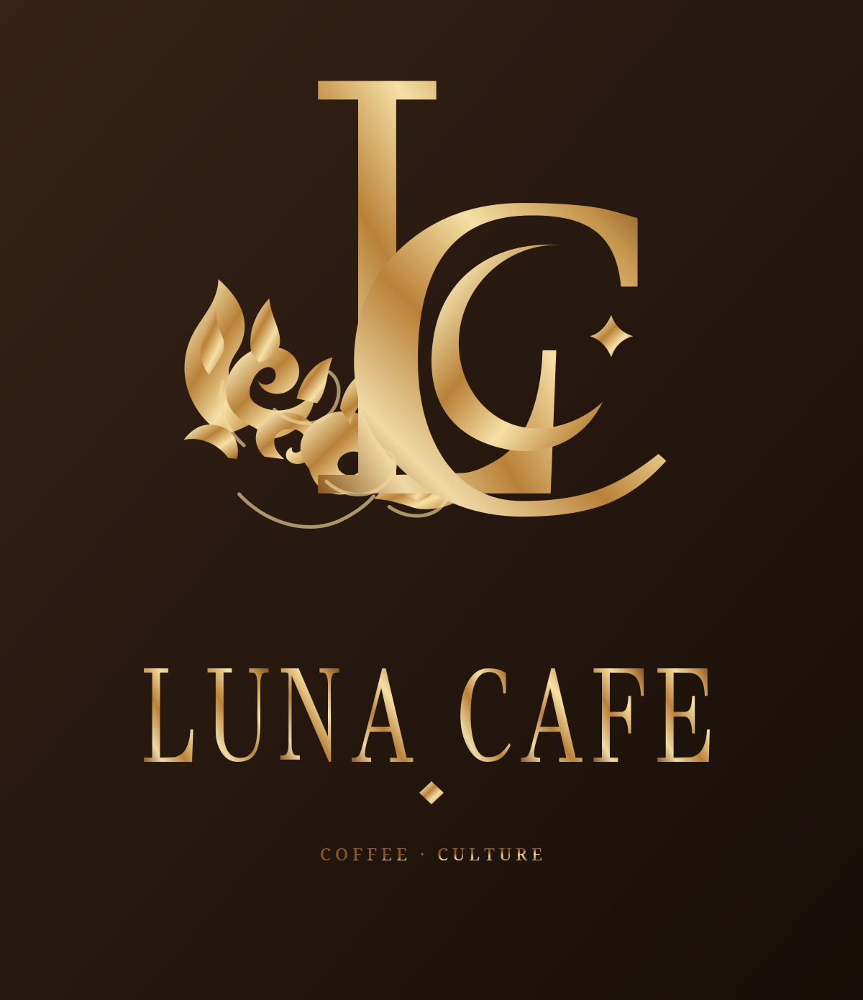
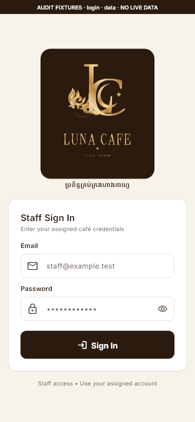
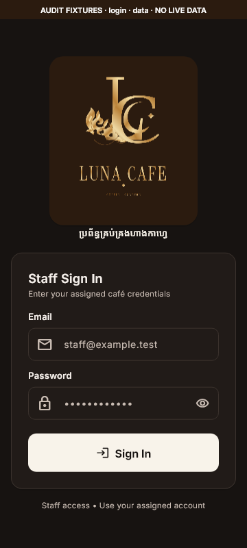
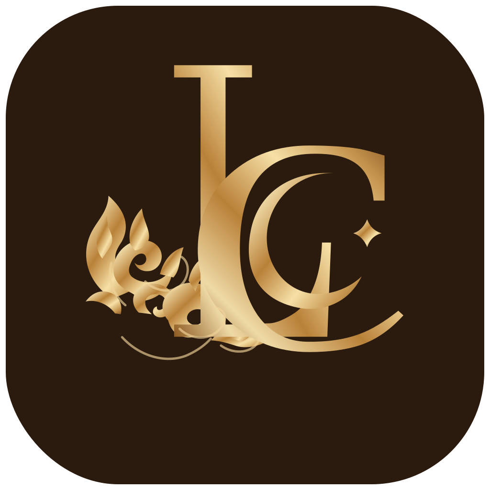

# Luna Cafe — supplied kit applied to the mobile app

The owner selected `design/Luna_Cafe_Vector_Logo_Kit` on 2026-10-15. The integration uses the kit's real outlined logo artwork and supplied PNG equivalents. **No new monogram geometry is generated or redrawn.** The earlier candidate has been removed from runtime assets and platform resources.

| Supplied kit artwork | Applied to mobile |
| --- | --- |
|  |  |
|  |  |
|  |  |

The supplied stacked logo retains its gold shading, LC, crescent, star, Khmer-inspired ornament and outlined wordmark. A coffee-brown backing makes the gold legible in both app themes. At shorter viewport heights the entire lockup scales down proportionally so the form remains reachable; the geometry is unchanged. Native UI text accompanies small header monograms, where the full lockup would be too dense.

The selected kit's square app icon has transparent rounded corners. Platform exports fill those corners with the matching supplied coffee color and encode iOS icons as opaque RGB; the OS applies its own mask. Android uses the kit's centered adaptive foreground and coffee background. A monochrome alpha-mask export preserves the same foreground geometry for themed icons.

- [48px Android icon](../../../../apps/mobile/android/app/src/main/res/mipmap-mdpi/ic_launcher.png), [20px iOS icon](../../../../apps/mobile/ios/Runner/Assets.xcassets/AppIcon.appiconset/Icon-App-20x20@1x.png).
- [Tablet login](../../previews/phase-8a/login-tablet-light.png), [dark tablet POS header](../../previews/phase-8a/pos-tablet-dark.png), [2× login](../../previews/phase-8a/login-phone-2x.png).
- [All phone/tablet captures](../../previews/phase-8a/README.md) and [source/asset guide](../../../../docs/frontend/luna-cafe-asset-integration.md).

Captures use native Flutter rendering with clearly marked synthetic fixtures. They are not real-device screenshots or live catalog data. Platform assets are prepared; Android/iOS OS rendering and device performance still require device verification.
