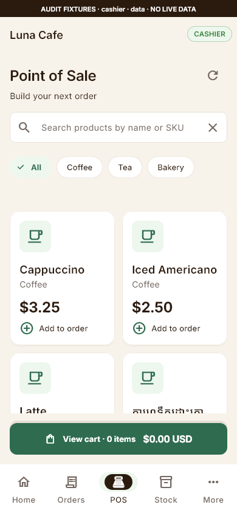
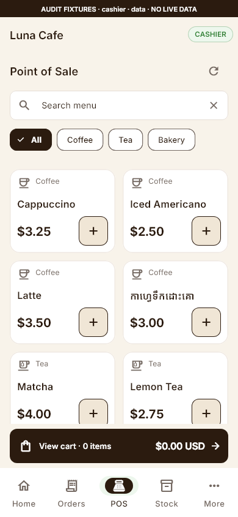
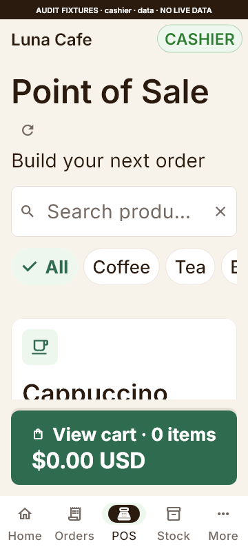
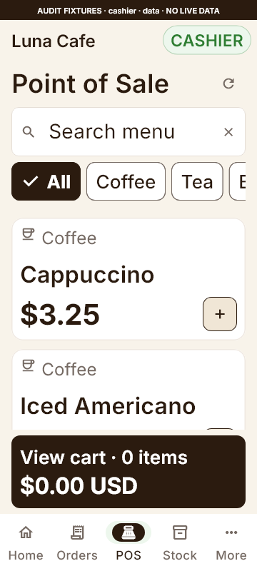
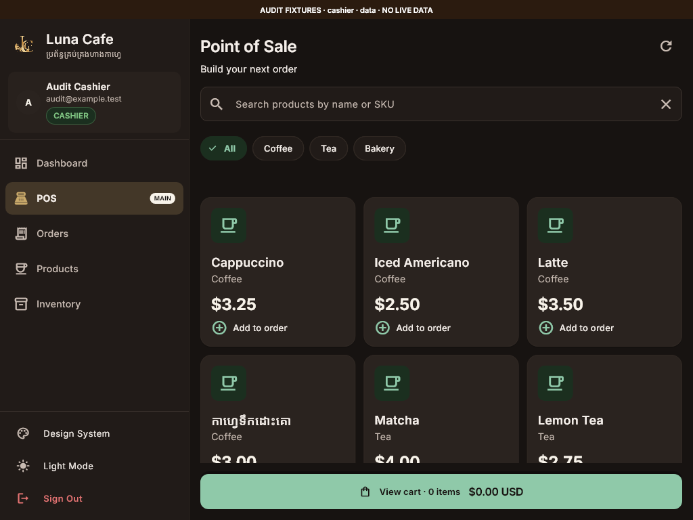
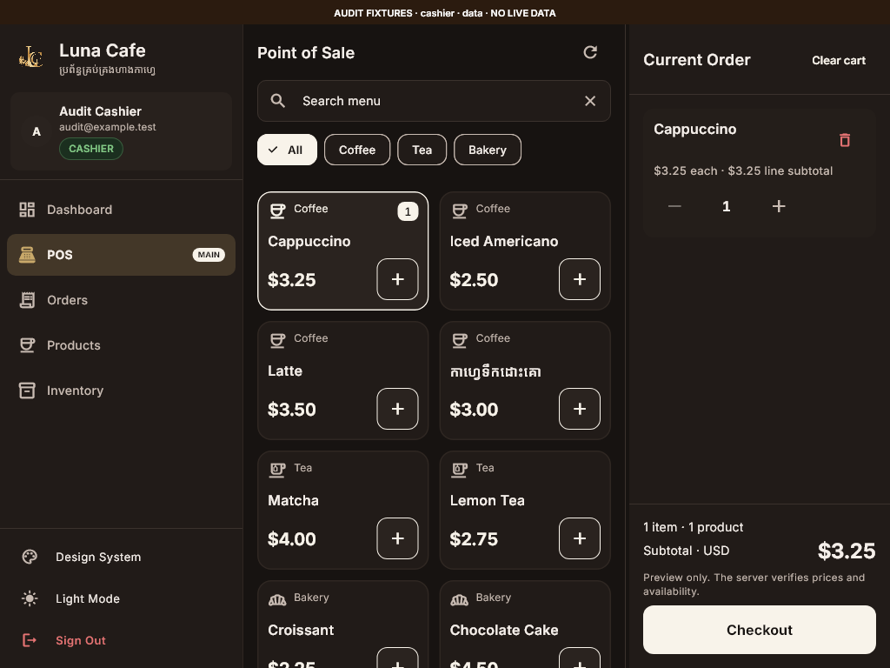
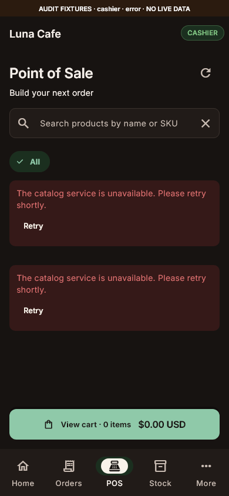
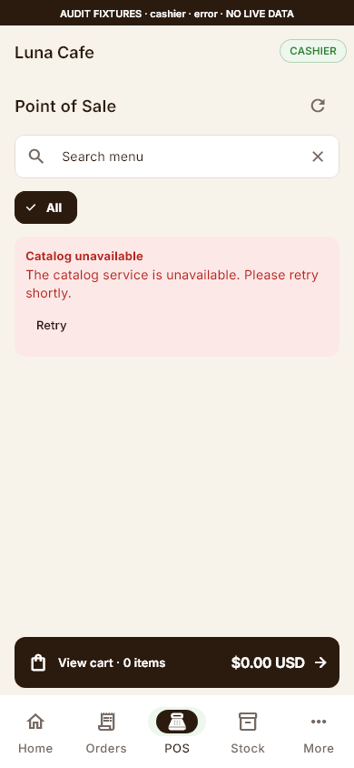

# Luna Cafe POS rescue — before and after

2026-10-15. These are **native Flutter widget captures with synthetic audit fixtures**, local Inter/Noto Sans Khmer and decoded supplied artwork. Names and prices are fixture values, not a new menu. All production catalog requests still use the existing authenticated Laravel repository. The nine Phase 8A originals are preserved.

| 390×844 light — before | 390×844 light — after |
| --- | --- |
|  |  |

The first product row starts at approximately **y277 instead of y348**: 71px less header overhead. Two complete rows fit above the allocated 56dp cart action. Category, name, price and add affordance have distinct hierarchy. Tea/bakery get different local Material glyphs; unknown labels get a neutral menu glyph. Product photography is deferred because the API has no authorized media field.

| 360×800 at 2× text — before | 360×800 at 2× text — after |
| --- | --- |
|  |  |

The operational header keeps refresh beside its title, search uses a short visible hint and its full accessible name, and the review action uses two concise lines. The first product and exact price are visible without shrinking operational text; further products scroll normally. Partially visible rows indicate scrollable content, not a product covered by an overlay.

| 1024×768 dark — before | 1024×768 dark — after |
| --- | --- |
|  |  |

The allocated 744dp POS region now fits two product columns beside a persistent draft cart. The quantity stepper remains horizontal and the subtotal/Checkout stay pinned at normal text size. Portrait tablets and 2× text use the review sheet when the existing sidebar leaves insufficient width. Controller/cart identity survives resizing. Sidebar navigation and its enlarged-text ellipses remain the separately gated 8B.2 work.

| Service outage — before | Service outage — after |
| --- | --- |
|  |  |

One equal two-stream failure has one notice and Retry, recovering both requests. Distinct failures retain their own messages/actions. Existing products and the cart survive refresh failures; pagination retries retain the exact requested pages.

## Additional review evidence

- [Phone cart](phone-cart.png), [360px dark cart at 2×](compact-cart-2x.png), [same review scrolled to Checkout](compact-cart-2x-checkout.png).
- [Phone dark at 2×](pos-phone-dark-2x.png), [portrait tablet dark](pos-tablet-portrait-dark-1x.png), [landscape tablet light at 2×](pos-tablet-landscape-light-2x.png).
- [Empty light](pos-phone-empty-light.png), [empty dark](pos-phone-empty-dark.png), [large-text compact outage](pos-compact-error-dark-2x.png), [large-text tablet empty](pos-tablet-landscape-empty-light-2x.png).
- [Static loading light](pos-phone-loading-light.png), [static loading dark](pos-phone-loading-dark.png). No continuous shimmer. Loading bars are decorative and the loading message is accessible.
- [Android emulator profile capture](emulator-pos-profile.png) and [measured timing/memory data](profile-evidence.json). This is a separate **1344×2992 software-GPU emulator** capture, not a physical-device screenshot or one of the widget baselines.

## Capture matrix and reproduction

**54 widget capture checks:** four viewports × two themes × two text scales × three states (data/empty/error) = 48; two loading states; four draft-cart views. Each asserts no framework exception and decoded brand pixels. Captures are review artifacts, not golden assertions. All PNGs remain outside `pubspec.yaml` and the runtime bundle.

| Viewport label | Logical pixels | Themes | Text scales | States |
| --- | --- | --- | --- | --- |
| `phone` | 390×844 | light/dark | 1×/2× | data/empty/error |
| `compact` | 360×800 | light/dark | 1×/2× | data/empty/error |
| `tablet-portrait` | 768×1024 | light/dark | 1×/2× | data/empty/error |
| `tablet-landscape` | 1024×768 | light/dark | 1×/2× | data/empty/error |

Data files are `pos-{viewport}-{theme}-{scale}x.png`. Empty/error files add the state before the theme; phone 1× state captures omit the `-1x` suffix. The existing nine baseline captures are not regenerated by this command.

```powershell
cd apps/mobile
flutter test tool/luna_pos_rescue_capture_test.dart --reporter expanded
# Interactive read-only preview; all write requests deliberately fail.
flutter run -d DEVICE_ID -t tool/luna_audit_preview.dart
# Native profile, 60 seconds; exercise catalog/add/review during sampling.
flutter run --profile -d DEVICE_ID -t tool/luna_pos_profile.dart
```

The profile tool prints `LUNA_POS_PROFILE` JSON containing frame count, build/raster/total-span percentiles and a sample excluding the first five seconds. Idle seconds do not count as rendered frames. Fixture captures cannot prove live catalog contents, payment success, native iOS behavior, TalkBack or fluent Khmer review.
