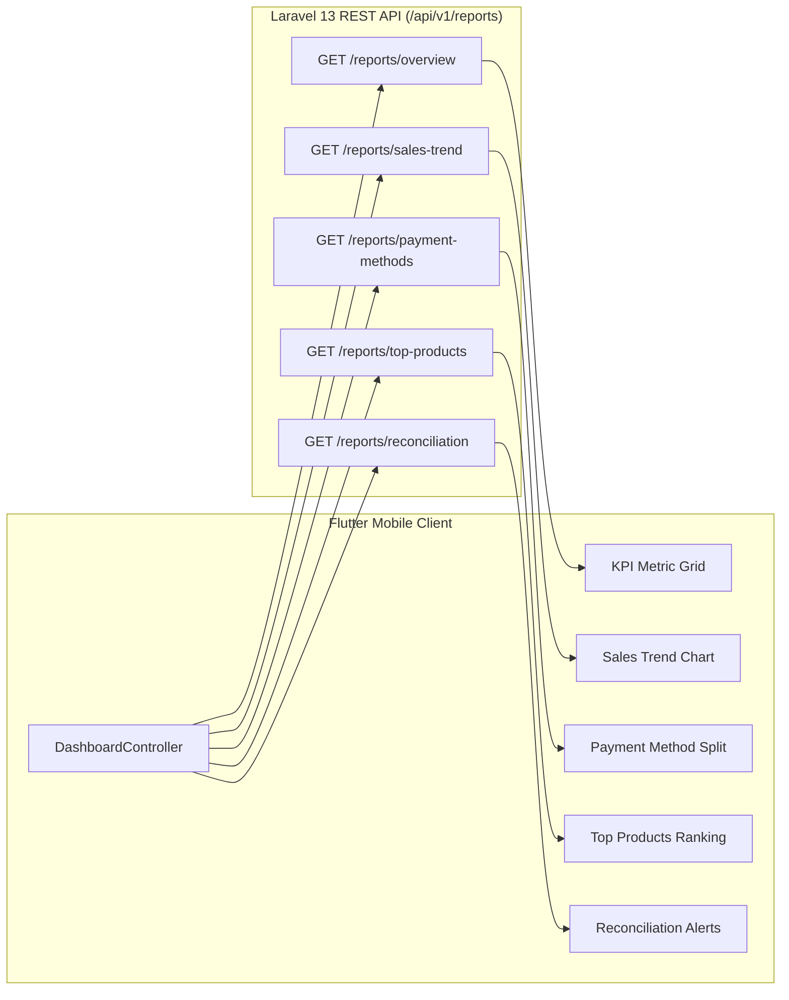

# Premium Café OS — Manager Mobile Dashboard Specification

> Implementation status: planned (Phase 8B), pending the Phase 8A review gate. The JSON below is illustrative and differs from the frozen backend. Use the [verified Phase 8 contract audit](luna-cafe-phase-8-audit.md) and current Laravel requests/services, including integer-string amounts, max-50 top products and date-independent reconciliation pagination. Label accepted paid revenue accurately; the external payment adapter is disabled and these examples do not establish live KHQR/Card support.

## 1. Executive Summary & Architecture

This specification defines the mobile and tablet user experience for the **Manager Dashboard & Operational Analytics** in the Coffee Management System (`apps/mobile`).

The dashboard provides real-time operational visibility, financial tracking, inventory monitoring, and exception resolution for café managers and store administrators.

### Core Architectural Invariants
- **Platform:** Flutter / Dart mobile client (Android and iOS smartphones, counter-mounted tablets).
- **Backend API:** Authoritative Laravel REST API (`/api/v1/reports/*`) backed by MySQL 8.0+.
- **Zero Floating-Point Calculations:** All monetary figures are rendered and computed in authoritative integer USD cents (`int`), eliminating rounding errors and IEEE-754 precision drift.
- **Store-Timezone Grounding:** Date ranges adhere to the authoritative `shop_timezone` setting (e.g., `Asia/Phnom_Penh`), converted to half-open UTC intervals `[startOfDay(from_date), startOfDay(to_date + 1 day))`.
- **RBAC Security Gate:** Gated by the `view-reports` server capability. Only `Manager` and `Admin` roles have access; `Cashier` users are strictly routed to `/pos` with no dashboard access.
- **Strict Read-Only Projections:** All report queries are zero-mutation, appending zero database writes or status modifications.

---

## 2. API Endpoint Mapping & Data Contracts

The dashboard maps directly to the frozen Phase 7 reporting endpoints without introducing any new backend endpoints or schema modifications:



### 2.1 Executive Overview (`GET /api/v1/reports/overview`)
- **Query Parameters:** `from_date` (YYYY-MM-DD), `to_date` (YYYY-MM-DD).
- **Backend Response Structure:**
  ```json
  {
    "data": {
      "currency": "USD",
      "revenue_minor": 145025,
      "paid_orders": 86,
      "average_order_value_minor": 1686,
      "low_stock_items": 3,
      "reconciliation_required_orders": 0,
      "period": {
        "from": "2026-10-01",
        "to": "2026-10-15",
        "timezone": "Asia/Phnom_Penh"
      }
    }
  }
  ```
- **UI Presentation:** 4 primary `AppMetricCard` widgets in a responsive 2x2 grid (mobile) or 4x1 row (tablet).

### 2.2 Chronological Sales Trend (`GET /api/v1/reports/sales-trend`)
- **Query Parameters:** `from_date`, `to_date`.
- **Response Contract:** Array of daily buckets with zero-filled empty days:
  ```json
  {
    "data": [
      {
        "date": "2026-10-14",
        "revenue_minor": 78250,
        "paid_orders": 44,
        "average_order_value_minor": 1778
      },
      {
        "date": "2026-10-15",
        "revenue_minor": 66775,
        "paid_orders": 42,
        "average_order_value_minor": 1589
      }
    ]
  }
  ```
- **UI Presentation:** Smooth Flutter `CustomPainter` line/bar sparkline showing revenue trajectory with date tooltips and tabular figures.

### 2.3 Payment Method Breakdown (`GET /api/v1/reports/payment-methods`)
- **Query Parameters:** `from_date`, `to_date`.
- **Response Contract:**
  ```json
  {
    "data": [
      {
        "method": "cash",
        "label": "Cash",
        "orders_count": 62,
        "total_minor": 98500,
        "share_percentage": 67.92
      },
      {
        "method": "external",
        "label": "External (KHQR/Card)",
        "orders_count": 24,
        "total_minor": 46525,
        "share_percentage": 32.08
      }
    ]
  }
  ```
- **UI Presentation:** Visual donut chart or proportion bar using Forest Green (Cash) and Caramel (External), accompanied by formatted total amounts and percentage badges.

### 2.4 Top Products by Volume & Revenue (`GET /api/v1/reports/top-products`)
- **Query Parameters:** `from_date`, `to_date`, `limit` (default 5, max 100).
- **Response Contract:** Ranked array by `revenue_minor DESC, quantity DESC`:
  ```json
  {
    "data": [
      {
        "product_id": 1,
        "product_name": "Iced Latte",
        "category_name": "Espresso",
        "quantity_sold": 48,
        "revenue_minor": 15600,
        "unit_price_minor": 325
      }
    ]
  }
  ```
- **UI Presentation:** High-density rank list with product name, quantity pill badge, and formatted revenue in tabular monospace figures.

### 2.5 Reconciliation & Operational Alerts (`GET /api/v1/reports/reconciliation`)
- **Response Contract:** Orders flagged `reconciliation_required = true` or payment attempts requiring supervisor attention.
- **UI Presentation:** `AppFeedbackBanner(variant: FeedbackBannerVariant.warning)` highlighting pending reconciliation exceptions with direct one-tap navigation to the Order Detail view.

---

## 3. Screen Layout & Responsive Design

### 3.1 Compact Mobile Viewport (<600dp — Smartphones)
1. **Sticky Top Bar:** Store title, active date preset chip (`Today`, `7 Days`, `30 Days`, `Custom Range`), and refresh action.
2. **Exception Banner:** Appears only when `reconciliation_required_orders > 0` or low-stock items exist.
3. **KPI Grid (Single/Double Column):**
   - **Gross Sales:** `$1,450.25 USD` (`AppMetricCard` with positive revenue badge).
   - **Completed Orders:** `86 tickets` (`AppMetricCard` with cart icon).
   - **Average Ticket:** `$16.86 USD` (`AppMetricCard` with tabular digits).
   - **Low Stock Items:** `3 items` (`AppMetricCard` with warning badge).
4. **Daily Sales Trajectory:** Responsive sparkline card with interactive tap inspection.
5. **Payment Method Proportions:** Visual segmented bar with cash/digital split.
6. **Top 5 Bestsellers:** Rank list card with quantity and revenue callouts.

### 3.2 Expanded Tablet Viewport (≥600dp — Counter POS & Tablets)
```text
┌───────────────────────────────┬─────────────────────────────────────────────────────────┐
│ Persistent Sidebar (280dp)   │ Main Dashboard Content (Scrollable)                     │
│                               │                                                         │
│  [Logo] Coffee Management     │  Header: Operational Dashboard (Asia/Phnom_Penh)        │
│  Manager Vibol (MANAGER)      │  Filter: [Today] [7 Days] [30 Days] [Date Range Picker] │
│                               ├─────────────────────────────────────────────────────────┤
│  • Dashboard (Active)         │  [ KPI 1: Revenue ]  [ KPI 2: Orders ]                  │
│  • POS                        │  $1,450.25 USD       86 tickets                         │
│  • Orders                     │                                                         │
│  • Inventory                  │  [ KPI 3: Avg Order ] [ KPI 4: Low Stock ]              │
│  • Settings                   │  $16.86 USD          3 items                            │
│                               ├────────────────────────────┬────────────────────────────┤
│  [Dark Mode] [Sign Out]       │  Daily Revenue Trend       │  Payment Distribution      │
│                               │  [====== Sparkline ======] │  Cash: 68%  KHQR: 32%      │
│                               ├────────────────────────────┴────────────────────────────┤
│                               │  Top Performing Menu Items (Revenue & Volume)           │
│                               │  #1 Iced Latte       48 sold    $156.00 USD             │
│                               │  #2 Cappuccino       32 sold    $104.00 USD             │
└───────────────────────────────┴─────────────────────────────────────────────────────────┘
```

---

## 4. Accessibility & Touch Ergonomics

- **Minimum Touch Target:** All interactive filter chips, date buttons, and report refresh actions enforce minimum 48×48dp touch targets.
- **Bilingual English + Khmer:** Typography hierarchy (`AppTypography.h2`, `h3`, `title`, `label`) maintains safe line-heights (1.35–1.45) to prevent vertical clipping of Khmer subscript consonants (*cheung*) or vowel diacritics.
- **2.0x Text Scaling Safety:** All metric cards use `Flexible` text blocks and `Wrap` layouts to accommodate 2.0x dynamic type scaling without layout overflows.
- **Screen Reader Announcements:** High-priority KPIs include structured semantic descriptions (e.g., `Semantics(label: "Gross revenue $1,450.25 USD across 86 completed orders")`).
- **Cumulative Layout Shift (CLS = 0):** Uses `AppSkeletonCard` and `AppSkeletonBox` placeholders matching exact card dimensions during network fetching.

---

## 5. Implementation Roadmap for Phase 8

1. **Domain Layer:** Implement pure Dart entities: `ReportOverview`, `DailySalesBucket`, `PaymentMethodStat`, `TopProductStat`, `ReportPeriod`.
2. **Data Layer:** Implement `ApiReportsRepository` communicating with `/api/v1/reports/*` with strict error handling (`401` session revocation, `403` role gating, `409` timezone errors).
3. **Application Layer:** Implement `DashboardController` (`ChangeNotifier`) orchestrating concurrent fetch of overview, trend, payment, and product statistics.
4. **Presentation Layer:** Build `DashboardPage`, `SalesTrendChart`, `PaymentDistributionWidget`, and `TopProductsWidget` utilizing `AppMetricCard`, `AppCard`, and `StatusBadge`.
5. **Testing & QA:** Comprehensive unit and widget tests covering light/dark themes, 2.0x text scaling, 403 Cashier restrictions, and error recovery.
