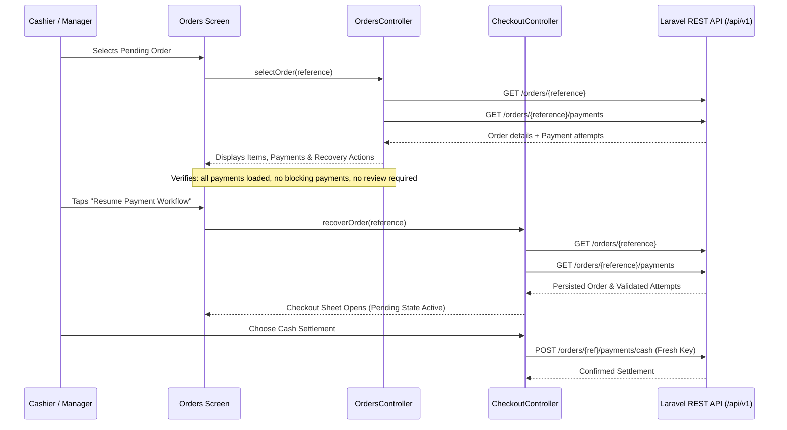

# Flutter Phase 6 — Order History & Status Tracking

The mobile application now replaces the previous `/orders` destination placeholder with an authentic, mobile-first Order History and Status Tracking feature. Cashiers and managers can discover, inspect, and safely recover persisted orders through the frozen Laravel REST API.

## Architecture and layer boundaries

```text
┌─────────────────────────────────────────────────────────────┐
│                       Presentation                          │
│                                                             │
│   OrdersPage (Responsive Phone + Tablet Master-Detail)       │
│   OrderDetailPage (Mobile Navigation Destination)            │
│   OrderDetailView (Master-Detail Reusable Inspector)         │
│   OrderCard, OrderStatusFilterBar, OrderDateFilterBar        │
│   OrderItemsSection, OrderPaymentSection, RecoverySection   │
│   OrdersController (Session-scoped List & Detail State)     │
└──────────────────────────────┬──────────────────────────────┘
                               │
                               ▼
┌─────────────────────────────────────────────────────────────┐
│                          Domain                             │
│                                                             │
│   OrderFilter (Allowlisted Query Parameters & Date Ranges)   │
│   OrderPage (Pagination Metadata & Items)                    │
│   OrderHistoryRepository (Abstract Contract)                │
│   OrderHistoryFailure & OrderHistoryFailureKind              │
│   Order & Payment (Reused from Phase 5 Domain Models)        │
└──────────────────────────────┬──────────────────────────────┘
                               │
                               ▼
┌─────────────────────────────────────────────────────────────┐
│                           Data                              │
│                                                             │
│   ApiOrderHistoryRepository (Frozen API Transport)          │
│   OrderHistoryDto (Strict Resource & Pagination Decoding)    │
│   CatalogDto & CheckoutDto (Reused Value Decoders)          │
│   ApiClient (Sanctum Bearer Token & Redacted Diagnostics)   │
└─────────────────────────────────────────────────────────────┘
```

| File in `apps/mobile/lib/` | Responsibility |
| --- | --- |
| `features/orders/domain/order_filter.dart` | Immutable filter criteria validating `created_from <= created_to` and producing strictly allowlisted query parameters (`status`, `created_from`, `created_to`, `page`, `per_page`). |
| `features/orders/domain/order_history_repository.dart` | Pure Dart contract for paginated orders query, authoritative single order lookup, and payment attempt history. |
| `features/orders/data/order_history_dto.dart` | Resource decoding strictly verifying pagination offset coherence, unique order references, and unique payment identities. |
| `features/orders/data/api_order_history_repository.dart` | Production implementation consuming frozen Laravel endpoints, URL-encoding parameters, redacting authorization bearer tokens, and mapping API exceptions. |
| `features/orders/presentation/orders_controller.dart` | Session-scoped state machine managing list filtering, incremental pagination, stale response generation counters, order selection, and settlement recovery eligibility. |
| `features/orders/presentation/orders_page.dart` | Responsive order history screen switching between compact phone view and tablet master-detail layout. |
| `features/orders/presentation/order_detail_page.dart` | Dedicated mobile scaffold for phone navigation to order inspection. |
| `features/orders/presentation/widgets/order_card.dart` | High-contrast accessible card (≥48dp touch target) displaying public reference, status badge, items count, and exact cents price. |
| `features/orders/presentation/widgets/order_status_filter_bar.dart` | Horizontal scrollable `ChoiceChip` filter bar supporting `All`, `Pending`, `Paid`, `Cancelled`, and `Expired`. |
| `features/orders/presentation/widgets/order_date_filter_bar.dart` | Horizontal scrollable date-range picker bar displaying device timezone offset (`UTC+07:00`) and quick reset actions. |
| `features/orders/presentation/widgets/order_items_section.dart` | Card presenting immutable snapshot of line items, SKU, unit price, quantity, and exact minor-unit financial totals. |
| `features/orders/presentation/widgets/order_payment_section.dart` | Settlement card presenting verified payment details (method, tender, change) and chronological payment attempts. |
| `features/orders/presentation/widgets/order_recovery_section.dart` | Action panel enabling safe resumption of checkout payment workflow or cancellation for clean pending orders. |
| `features/orders/presentation/widgets/order_detail_view.dart` | Reusable master-detail view shared between tablet right pane and compact `OrderDetailPage`. |
| `features/pos/presentation/checkout_controller.dart` | Added `recoverOrder(reference)` entry point adopting persisted orders and loading authoritative payment states without replaying past idempotency keys. |

## Frozen backend API integration

The mobile application strictly consumes the frozen Laravel endpoints without requesting backend modifications:

1. **`GET /api/v1/orders`**:
   - Query parameters: `status` (`pending_payment`, `paid`, `cancelled`, `expired`), `created_from` (ISO-8601), `created_to` (ISO-8601), `page`, `per_page`.
   - Client sends strictly allowlisted parameters. Unsupported query parameters (`search`, `sort`, `order_by`, `user_id`, `created_by`) are strictly excluded.
   - Cashier ownership scope vs. manager/admin shop-wide scope is enforced server-side.
2. **`GET /api/v1/orders/{reference}`**:
   - Fetches authoritative single order details by public reference (`ORD-<ULID>`).
3. **`GET /api/v1/orders/{reference}/payments`**:
   - Fetches paginated payment attempts for the order. Unauthoritative server pagination links are ignored to prevent SSRF/untrusted redirects.

## Safe order recovery & payment security



### Security constraints enforced:
1. **Never fabricate idempotency keys on discovery**: Discovered orders never reuse previous operation keys or generate arbitrary keys for historical attempts.
2. **Never automatically take duplicate payments**: Opening or viewing an order is strictly read-only.
3. **Reconciliation gating**: If any payment attempt has `reconciliation_required = true`, recovery actions are locked and an explicit warning is displayed requiring manager review.
4. **In-flight block gating**: If an in-flight attempt blocks settlement (`initiated` or `pending`), settlement actions are disabled until reconciled or expired.
5. **Exact cents currency arithmetic**: All amounts remain in integer USD minor cents. No floating-point double math is performed.

## Mobile UX/UI & Accessibility

- **Compact Layout (<600dp)**: Clean single-column layout with quick status chips, native date range picker with timezone offset, pull-to-refresh, load more pagination, and push navigation to `OrderDetailPage`.
- **Tablet Master-Detail Layout (≥600dp)**: 380dp persistent left list with sticky filters and right detail panel updating interactively without pushing routes.
- **Large Text Scaling (2.0x)**: Designed with `Wrap`, `ConstrainedBox`, and horizontal scroll bars to ensure zero `RenderFlex` clipping or text overflow across all screens (320px phone to 1440px desktop).
- **Accessible Touch Targets**: All interactive elements (chips, buttons, date triggers, order cards) meet or exceed the 48×48dp touch target standard.
- **Semantic Badges**: High contrast badges combining text, background, border, and semantic labels to support users with color vision deficiencies.

## Verification results

```text
Flutter Test Suite (apps/mobile):
533 passed (471 baseline + 62 new Phase 6 tests), 0 failures

Flutter Analyzer (apps/mobile):
0 issues, 0 warnings, 0 hints

Flutter Code Formatting:
100% compliant with dart format

Mobile Compilation Build:
Android debug APK built successfully:
build\app\outputs\flutter-apk\app-debug.apk (48.7s)

Backend Regression Suite (apps/backend):
380 passed, 2347 assertions, 73 skips, 0 failures (91.09s)
```
