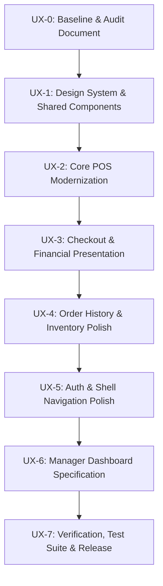

# Premium Café OS — UX/UI Modernization Audit & Architectural Baseline

## 1. Executive Summary & Objective

The **Premium Café OS** modernization initiative elevates the existing working Flutter mobile application (`apps/mobile`) into an artisanal, high-throughput, commercial-grade coffee shop Point of Sale (POS) and operations suite.

The system is built for fast-paced Cambodian café environments, serving cashiers, baristas, managers, and store administrators on Android smartphones, iPhones, and counter-mounted tablets.

### Core Philosophy
> **"Premium design, minimal friction, maximum trust."**

This modernization adheres strictly to zero functional, financial, or security regression:
- **Zero Floating-Point Money:** All financial transactions remain strictly in exact integer USD cents (`int`), with zero floating-point arithmetic or rounding drift.
- **Fixed-Point Inventory Quantities:** Inventory balances, movements, and recipe allocations remain strictly in authoritative fixed-point integer subunits (`DECIMAL(14,4)` with scale 10,000).
- **Authoritative Server Security:** Laravel Sanctum bearer token authentication, server-validated roles and permissions, allowlisted query parameters, and append-only audit tracking remain inviolate.
- **Strict Idempotency:** Financial checkout and inventory mutations preserve stable in-memory idempotency keys with replay defense across network timeouts.
- **Preserved Clean Architecture:** Feature-first structure (`presentation`, `domain`, `data`, `application`) is preserved without leaking network or business logic into UI widgets.

---

## 2. Multi-Dimensional UX/UI Baseline Audit

An exhaustive audit of the existing Flutter mobile codebase was conducted across visual aesthetics, touch ergonomics, bilingual accessibility, motion feedback, and system performance.

### 2.1 Visual Design & Aesthetic System
| Dimension | Current Baseline State | Modernized Target State | Gap & Remediation Strategy |
| :--- | :--- | :--- | :--- |
| **Palette Proportions (60-25-10-5)** | Implemented via `AppColors`: Warm Cream (`#FAF7F2`), Espresso (`#3A2618`), Forest Green (`#2F6B4F`), Caramel (`#D68A3A`). | Elevated surface hierarchy with semantic tinting (`surfaceContainerLowest`, `surfaceContainerLow`, `surfaceContainerHigh`). | Add subtle contrast borders (`#E5DECE` light, `#352B24` dark) and layered surface fills to distinguish nested cards from flat backgrounds. |
| **Elevation & Depth** | Flat zero-elevation across cards (`elevation: 0`). Cards rely solely on 1px solid borders. | Subtle, refined micro-elevations (0.5dp to 2dp blur) with soft ambient drop shadows and tactile pressed states. | Introduce `AppElevation` tokens with subtle ambient shadows for interactive cards and floating action bars while avoiding heavy skeuomorphism. |
| **Visual Hierarchy** | Monolithic text blocks and uniform card structures in POS and inventory lists. | Distinct visual zoning: Primary KPI callouts, secondary metadata tags, and tertiary auxiliary timestamps. | Introduce `AppMetricCard` and `AppStatusBadge` variants with tonal fills and distinct typography. |
| **Dark Theme Fidelity** | Deep Espresso Dark (`#171311` canvas, `#211B18` surface). | Refined contrast with luminous accent tokens (`#E8A054` Caramel, `#428C68` Green). | Verify WCAG AAA (7:1) contrast for primary text and AA (4.5:1) for secondary text across dark mode. |

### 2.2 Usability & Touch Ergonomics
| Dimension | Current Baseline State | Modernized Target State | Gap & Remediation Strategy |
| :--- | :--- | :--- | :--- |
| **Touch Targets** | 48×48dp enforced on main buttons, but some list trailing buttons and chips measure ~36–40dp. | Uncompromising **48×48dp** minimum touch target bounding box across all interactive elements, icon buttons, and steppers. | Wrap compact icons in `SizedBox(width: 48, height: 48)` or use `IconButton` with `visualDensity: VisualDensity.standard` and 48dp constraints. |
| **Cart Quantity Stepper** | Separate round `-` and `+` icon buttons separated by plain text. | Unified, high-confidence `AppQuantityStepper` component with tactile feedback, minimum 48dp buttons, and clear quantity display. | Consolidate quantity controls into an encapsulated widget with debounced taps and clear visual state. |
| **Thumb-Zone Reachability** | Actions occasionally positioned near top app bars on phone screens (e.g., search clear, quick filter). | Bottom-sheet actions and bottom-anchored checkout buttons on mobile phones (<600dp). | Keep primary operational triggers within the lower 60% of the viewport on compact devices. |
| **Tablet POS Split Layout** | Tablet catalog (60%) and cart (40%) split layout exists but lacks fluid resizability and clear focus zones. | Polished dual-pane layout with persistent sticky cart footer, order summary card, and category rail navigation. | Optimize flex proportions (5:3 or 65:35) on ≥600dp screens with independent scrolling and elevation separation. |

### 2.3 Bilingual Accessibility (English & Khmer)
| Dimension | Current Baseline State | Modernized Target State | Gap & Remediation Strategy |
| :--- | :--- | :--- | :--- |
| **Khmer Consonant Clipping** | Fallback font chain (`Inter`, `Noto Sans Khmer`, `sans-serif`) with safe line heights (1.35–1.45) implemented. | Zero clipping guaranteed across all text styles, including buttons, badge chips, and table headers. | Audit all `Text` widgets to ensure no fixed `height: 1.0` or single-line constraints crop stacked consonants (*cheung* ជើងអក្សរ) or dual diacritics. |
| **Text Scale Factor (2.0x)** | Tested in Phase 1; some tight card layouts in POS and Order History risk vertical overflow at 2.0x. | Flexible, scrollable containers and responsive auto-wrapping for badges and price tags at 2.0x text scaling. | Replace rigid horizontal rows with `Wrap` or flexible column layouts when text scale factor exceeds 1.3x. |
| **Screen Reader Semantics** | Basic semantics present on form inputs. | Comprehensive semantic labels (`Semantics(button: true, label: ...)`) for icon-only buttons, badge statuses, and money totals. | Add explicit semantic announcements for cart changes, payment success, and network retry cooldowns. |

### 2.4 Motion & Feedback
| Dimension | Current Baseline State | Modernized Target State | Gap & Remediation Strategy |
| :--- | :--- | :--- | :--- |
| **Micro-Interactions** | Standard Flutter ink ripples; no tactile press compression. | Subtle press compression (`AppMotion.press`, 0.98 scale over 100ms) on product cards and buttons. | Introduce `BouncingTap` / interactive scale wrappers for high-frequency POS product tiles. |
| **Loading Transitions** | Generic circular progress indicators (`AppLoadingIndicator`) causing abrupt layout shifts. | Shimmering skeleton loaders (`AppSkeletonCard`, `AppSkeletonItem`) maintaining zero layout shift (CLS = 0). | Provide skeleton placeholders matching exact item dimensions during category and product fetching. |
| **Feedback Banners** | Basic snackbars used for transient messages. | Non-blocking, contextual inline feedback banners (`AppFeedbackBanner`) with auto-dismiss and action links. | Replace intrusive snackbars with clear inline alerts for idempotent retry cooldowns, offline warnings, and stock warnings. |

---

## 3. Dependency Decision Matrix

A critical architectural decision in professional mobile engineering is evaluating third-party dependencies versus native platform capabilities:

| Candidate Package | Potential Purpose | Decision | Technical Rationale |
| :--- | :--- | :--- | :--- |
| `lottie` | Animated illustrations & loaders | **REJECTED** | Large binary footprint (+1.8MB APK), potential rendering overhead on low-end retail devices. Custom Flutter `CustomPainter` and `AnimationController` provide lightweight, bespoke café animations with zero extra dependencies. |
| `flutter_svg` | Vector icons & illustrations | **REJECTED** | Material Icons (rounded/outlined) combined with Flutter geometric shapes provide 100% of required iconography with zero parsing latency and zero C++ library dependencies. |
| `cached_network_image` | Image caching & placeholders | **REJECTED** | Backend currently does not serve dynamic media/binary images (products use text and category badges). Adding image libraries now violates the "no unused dependencies" rule. |
| `flutter_screenutil` | Screen scaling utilities | **REJECTED** | Hardcoded scale multipliers break Flutter's native declarative layout system and violate WCAG 2.0x text-scaling guidelines. Flutter's built-in `LayoutBuilder` and `MediaQuery` breakpoints (`Breakpoints.compact`, `Breakpoints.medium`, `Breakpoints.expanded`) are architecturally superior. |
| `shimmer` | Skeleton shimmer animation | **REJECTED** | A lightweight custom `ShimmerBox` built with a single `LinearGradient` and `AnimationController` accomplishes identical visual polish in ~40 lines of clean Dart without adding external maintenance overhead. |

### Architectural Conclusion
**Zero (0) new third-party dependencies will be introduced.**
The modernization relies 100% on Flutter standard library primitives, Material 3 design tokens, and existing audited dependencies (`http`, `flutter_secure_storage`, `go_router`).

---

## 4. Phased Modernization Plan (UX-1 through UX-7)

### UX-1: Design System Refinement & Reusable Components
- Refine `app_theme.dart`, `app_colors.dart`, `app_radius.dart`, and `app_motion.dart`.
- Enhance existing shared widgets: `AppButton`, `AppCard`, `AppTextField`, `StatusBadge`, `AppEmptyState`.
- Introduce new reusable café components:
  - `AppMetricCard`: High-impact KPI display with trend indicators and tabular numerics.
  - `AppSearchField`: Debounced search bar with active filter pill integration and instant clear button.
  - `AppQuantityStepper`: Ergonomic increment/decrement control with 48dp touch targets.
  - `AppFeedbackBanner`: Contextual inline notification banner with status color coding.
  - `AppSkeletonLoader`: Subtle shimmer placeholder for products, orders, and stock items.

### UX-2: Core POS Modernization
- Polish `PosPage`, `PosProductCard`, and `PosCartPanel`.
- Implement smooth category selection chips with caramel accent indicators.
- Refine product card layout with clear price tags, stock badges, and tactile tap feedback.
- Optimize tablet split-screen master-detail layout (catalog on left, cart panel on right).
- Verify 2.0x text scaling and zero layout overflow.

### UX-3: Checkout & Financial Presentation
- Polish `CheckoutSheet` and payment modal workflows.
- Enhance cash tender keypad with large, responsive numeric keys (min 56dp height).
- Clean up change calculation display with high-contrast forest green confirmation.
- Present external payment states neutrally (pending, scanning, reconciling) with clear visual reassurance.
- Ensure safe retry countdown and idempotency protection are clearly surfaced without alarmist UI.

### UX-4: Order History & Inventory Screens
- Polish `OrdersPage` with clear status chips, date-range picker, and order detail slide-over sheet.
- Polish `InventoryPage` with low-stock warning banners, balance cards, and movement audit dialogs.
- Enforce tabular monospace figures for all stock quantities and timestamps.
- Maintain cashier read-only mode vs manager/admin operational permissions.

### UX-5: Auth & Navigation Polish
- Refine `LoginPage` with warm café branding, subtle illustration, and accessible password reveal toggle.
- Polish `AdaptiveAppShell` with smooth destination transitions, active badge indicators, and role-based badge pills.
- Optimize bottom navigation bar on mobile (<600dp) and persistent navigation rail/sidebar on tablet (≥600dp).

### UX-6: Manager Dashboard Specification
- Produce `docs/frontend/manager-dashboard-specification.md`.
- Map UI dashboard widgets to existing frozen backend endpoints (`/reports/overview`, `/reports/sales-trend`, `/reports/payment-methods`, `/reports/top-products`, `/reports/inventory`).
- Specify KPI metrics, trend visualizers, role-gating (Manager/Admin only), and date-filtering.

### UX-7: Verification, Regression Testing & Upstream Push
- Run complete verification: `flutter analyze`, `flutter test` (ensuring 100% green across all tests), `flutter build apk --debug`.
- Validate backend compatibility (`php artisan test`).
- Push to remote `origin/main` and verify green GitHub Actions CI status.
- Deliver comprehensive final release report.
